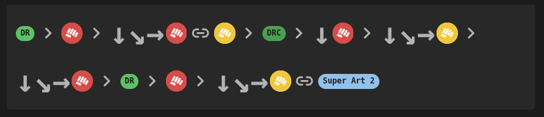
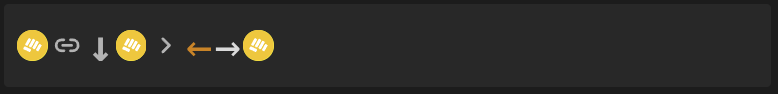

# Fighting Game Notation

Render fighting game combo notation directly in your Obsidian notes. Write inputs in plain text using standard numpad notation, and the plugin turns them into styled blocks with directional arrows, button icons and badges.



---

## Supported games

| Code block | Game |
|---|---|
| ` ```fg ` or ` ```fg-sf6 ` | Street Fighter 6 |

---

## Usage

Wrap your notation in a fenced code block with the game's tag:

````markdown
```fg-sf6
2MK > 236HP
j.HP , 2MP > DRC 5HP > [4]6HP > SA3
```
````

Each line in the block renders as its own combo. Anything the plugin doesn't recognize is shown as plain text, so a typo never breaks the rest of the line.

---

## Notation

### Directions

Directions use numpad notation, where `5` is neutral:

| Input | Direction |
|---|---|
| `7` `8` `9` | ↖ ↑ ↗ |
| `4` `5` `6` | ← neutral → |
| `1` `2` `3` | ↙ ↓ ↘ |

### Motions

| Input | Motion |
|---|---|
| `236` | Quarter-circle forward |
| `214` | Quarter-circle back |
| `623` | Dragon punch |
| `421` | Reverse dragon punch |
| `41236` | Half-circle forward |
| `63214` | Half-circle back |
| `236236` | Double quarter-circle forward |
| `214214` | Double quarter-circle back |
| `360` | Full circle |
| `720` | Double full circle |
| `646` | Charge super (forward, back, forward) |
| `22` | Down, down |

A `.` between the motion and the button is optional, so `236LP` and `236.LP` are the same.

### Buttons

| Input | Button |
|---|---|
| `LP` `MP` `HP` | Light, medium, heavy punch |
| `LK` `MK` `HK` | Light, medium, heavy kick |
| `PP` `KK` | Two punches or two kicks (e.g. OD moves) |
| `PPP` `KKK` | All three punches or kicks |
| `THROW` | Throw |

### Prefixes

| Prefix | Meaning | Example |
|---|---|---|
| `j.` | Jumping | `j.HP` |
| `c.` | Close | `c.HP` |
| `f.` | Far | `f.HP` |
| `d.` | Delayed | `d.2MK` |
| `tk.` | Tiger knee | `tk.236LK` |

### Separators

| Symbol | Meaning |
|---|---|
| `>` | Cancel |
| `,` | Link |
| `~` | Chain |
| `+` | Pressed together |
| `/` | Or (alternative route) |

### Charge inputs

Put the held direction in brackets, followed by the release direction:

```fg-sf6
[4]6HP > [2]8KK
```

This means hold back, then press forward + HP; then hold down, then press up + KK.



Charge inputs aren't checked against any game's rules, so whatever you write is shown as written.

### Tiger knee

A tiger knee motion ends in an upward direction, usually to do a special move just off the ground. Write it either with the `tk.` prefix or by adding the up direction to the motion yourself. Both of these render the same:

```fg-sf6
tk.236LK
2369LK
```

### Grapplers

Full-circle motions work like any other motion, including on the ground, in the air and as a tiger knee:

```fg-sf6
5LP > 5MP > 360PP
j.360KK
720PPP
tk.360LP
```

### Dashes and microwalk

`66` and `44` on their own render as a forward or back dash. `j.66` is an air dash. `microwalk` (any capitalization) renders as a badge:

```fg-sf6
66 > 5HP
microwalk 2MK > 236HP
```

### Badges

These render as labeled badges and can appear anywhere in a line:

| Input | Badge |
|---|---|
| `DR` | Drive Rush |
| `DRC` | Drive Rush cancel |
| `DI` | Drive Impact |
| `SA1` `SA2` `SA3` (or `[SA1]` `[SA2]` `[SA3]`) | Super Art 1–3 |
| `[CH]` | Counter hit |
| `[PC]` | Punish counter |
| `WALLSPLAT` | Wall splat |
| `microwalk` | Microwalk |

---

## Examples

For a full reference, download the [example note](examples/Fighting%20Game%20Notation%20examples.md) and copy it into your vault. It covers every kind of notation, showing what to type next to how it renders.

````markdown
```fg-sf6
[PC] 2MK > DRC 5HP > 236HP
DI , WALLSPLAT 5HP > 623PP
2LP , 2LP / 2LP , 5LP > 214PP
c.HP > SA2
```
````

---

## Installation

Once the plugin is listed in Obsidian's community plugins:

1. Open **Settings → Community plugins** and turn off restricted mode if it's on.
2. Select **Browse**, search for "Fighting Game Notation", then select **Install** and **Enable**.

To install manually, download `main.js`, `manifest.json` and `styles.css` from the [latest release](https://github.com/Jeremy-Code-F/fg-notation-plugin/releases/latest) into `<vault>/.obsidian/plugins/fighting-game-notation/`, then enable the plugin under **Settings → Community plugins**.

## Compatibility

Works on Obsidian desktop and mobile. The plugin runs entirely offline: it makes no network requests and collects no data.

---

## Feedback and issues

Found a bug or want to request a game? Open an issue on the [GitHub repository](https://github.com/Jeremy-Code-F/fg-notation-plugin/issues).

## License

[MIT](LICENSE)

## Credits

The punch and kick button icons are based on [Punch blast](https://game-icons.net/1x1/lorc/punch-blast.html) and [Footprint](https://game-icons.net/1x1/lorc/footprint.html) by [Lorc](https://lorcblog.blogspot.com) from [game-icons.net](https://game-icons.net), licensed under [CC BY 3.0](https://creativecommons.org/licenses/by/3.0/). They were changed to show only the fist and placed on colored circles.

The separator icons are from [Lucide](https://lucide.dev) (chevron-right, link-2, plus and waves), licensed under the [ISC License](https://github.com/lucide-icons/lucide/blob/main/LICENSE), copyright Lucide Icons and Contributors.
